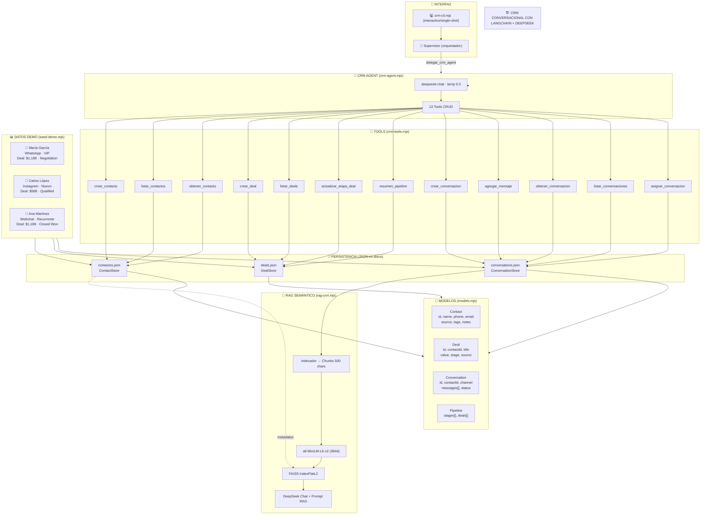

# 🏗️ CRM CONVERSACIONAL — Arquitectura completa
## Construido sobre el sistema multi-agente LangChain + DeepSeek



## 📂 Estructura de archivos

```
agentes/crm/
├── models.mjs            # Entidades: Contact, Deal, Conversation, Pipeline
├── crm-agent.mjs         # Agente LangGraph (mismo patrón que file-agent)
├── crm-cli.mjs           # CLI interactivo + single-shot
├── crm-server.mjs        # Servidor Express + Webhooks + Canales reales
├── seed-demo.mjs         # Siembra datos demo
├── rag-crm.mjs           # RAG sobre conversaciones (búsqueda semántica)
├── channels/
│   ├── whatsapp-channel.mjs  # WhatsApp real via Baileys (QR + mensajes)
│   ├── instagram-channel.mjs # Instagram via Graph API webhook
│   └── crm-bridge.mjs        # Puente: canal → CRM Agent → respuesta
├── tools/
│   └── crm-tools.mjs     # 13 DynamicStructuredTools CRUD
├── stores/
│   ├── base-store.mjs     # Store base con persistencia JSON
│   ├── contact-store.mjs  # CRUD + búsqueda de contactos
│   ├── deal-store.mjs     # CRUD + pipeline summary de deals
│   └── conversation-store.mjs # CRUD + transcript de conversaciones
└── data/
    ├── contacts.json      # Persistencia automática
    ├── deals.json
    ├── conversations.json
    ├── whatsapp-auth/     # Auth multi-device de Baileys
    └── faiss-conversations/  # Índice vectorial FAISS
```

## 🔄 Flujo completo

### CLI / Supervisor
```
1️⃣ USUARIO: "crea un contacto llamado Pedro"
   → crm-cli.mjs / index.mjs
   → crm-agent.mjs (LangGraph + DeepSeek)
   → createContactTool (DynamicStructuredTool)
   → ContactStore.put()
   → contactos.json (disco)
```

### Canales Reales (WhatsApp / Instagram)
```
2️⃣ CLIENTE: "Hola, quiero info del plan" (desde WhatsApp)
   → whatsapp-channel.mjs (Baileys WebSocket)
   → crm-bridge.mjs
      → Identifica/crea contacto por teléfono
      → Busca conversación activa o crea nueva
      → Guarda mensaje en ConversationStore
      → Invoca CRM Agent con contexto (historial + deals)
   → crm-agent.mjs (DeepSeek + Tools)
   → ¡Respuesta automática al cliente por WhatsApp!
   → Mensaje guardado en historial del CRM
```

### RAG / Consultas
```
3️⃣ USUARIO: "qué dijo María sobre precios?"
   → crm-cli.mjs
   → crm-agent.mjs
   → RAG: FAISS similaritySearch → DeepSeek responde con contexto
   → "María preguntó por el plan Professional..."
```

### Pipeline / Negocio
```
4️⃣ USUARIO: "mueve el deal de Carlos a negotiation"
   → index.mjs → Supervisor → delegar_crm_agent
   → crm-agent → updateDealStageTool
   → deals.json actualizado
```

## ⚡ Comandos

```bash
# Sembrar datos demo
node agentes/crm/seed-demo.mjs --force

# CLI interactivo del CRM
node agentes/crm/crm-cli.mjs

# Consulta directa (sin interactivo)
node agentes/crm/crm-cli.mjs "listar contactos"

# Indexar conversaciones en FAISS
node agentes/crm/rag-crm.mjs --index

# Consulta RAG sobre conversaciones
node agentes/crm/rag-crm.mjs --ask "qué dijo María?"

# Sistema completo con supervisor
node agentes/index.mjs "usando el crm-agent, crea un deal para María"

# SERVIDOR CON CANALES REALES
node agentes/crm/crm-server.mjs                         # Todo: Express + WhatsApp QR + Instagram webhook
node agentes/crm/crm-server.mjs --no-whatsapp           # Solo Instagram
node agentes/crm/crm-server.mjs --no-instagram          # Solo WhatsApp
node agentes/crm/crm-server.mjs --seed                  # Forzar seed + arrancar
```

## 🎯 Para la entrevista: Cómo explicarlo

| Te preguntan | Tu respuesta |
|---|---|
| "¿Cómo construiste el CRM?" | "Sobre mi sistema multi-agente existente. Extendí el mismo patrón de LangGraph + StateGraph + ToolNode, pero con herramientas de negocio (contactos, deals, conversaciones) en vez de herramientas de archivos." |
| "¿Cómo funciona la persistencia?" | "Cada store hereda de BaseStore que serializa a JSON en disco. Al arrancar carga todo en memoria (Map), y cada operación CRUD persiste automáticamente." |
| "¿Y el RAG en el CRM?" | "Mismo pipeline que el RAG de código: all-MiniLM-L6-v2 + FAISS. Solo que ahora indexo las conversaciones en vez del código fuente. 384 dimensiones, hybrid search opcional." |
| "¿Cuánto tiempo tomó?" | "Las bases (agentes, RAG, supervisor) ~3 semanas. El CRM específico (modelos, stores, tools, datos demo) ~4 horas. La arquitectura de agentes es reusable." |
| "¿Cómo manejas canales reales?" | "WhatsApp via Baileys (WebSocket, QR auth multi-device). Instagram via Graph API webhook. El Bridge unifica ambos: recibe mensaje → identifica/crea contacto → busca conversación → invoca CRM Agent → responde automáticamente. Todo queda persistido en el CRM." |
| "¿Qué sigue?" | "Dashboards con analíticas en tiempo real, sistema de reglas/triggers para automatizaciones, y workflows multi-paso." |
